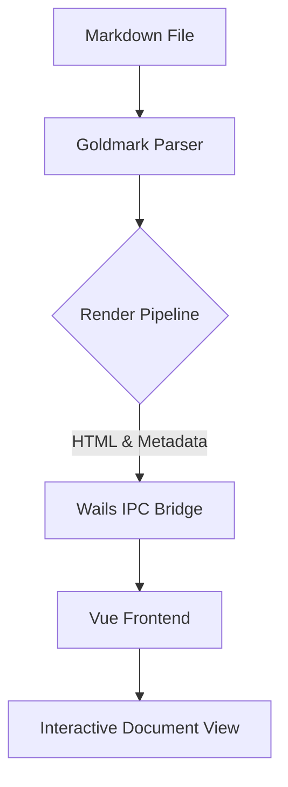
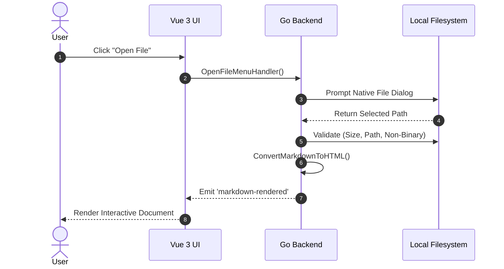

<!-- markdownlint-disable MD004 MD018 MD025 MD033 MD034 MD036 MD042 MD046 MD049 MD051 -->

# TextoVista Markdown Feature Showcase

Welcome to the **TextoVista** feature demonstration document. This file showcases the complete suite of CommonMark standards, GitHub Flavored Markdown (GFM) extensions, and integrated Goldmark plugins supported by the application.

## Table of Contents

- [Frontmatter & Document Metadata](#frontmatter--document-metadata)
- [CommonMark Typography & Formatting](#commonmark-typography--formatting)
- [Lists & Task Lists](#lists--task-lists)
- [Tables & Tabular Data](#tables--tabular-data)
- [Code Blocks & Syntax Highlighting](#code-blocks--syntax-highlighting)
- [Alert Callouts & Admonitions](#alert-callouts--admonitions)
- [Math Expressions (KaTeX)](#math-expressions-katex)
- [Diagrams & Visualizations (Mermaid & D2)](#diagrams--visualizations-mermaid--d2)
- [Extended Syntax & Attributes](#extended-syntax--attributes)
- [HTML & Security Sanitization](#html--security-sanitization)
- [Media, Figures & Links](#media-figures--links)

---

## Frontmatter & Document Metadata

TextoVista automatically parses YAML, TOML, and JSON frontmatter blocks positioned at the very start of a document.

Metadata attributes such as `Title`, `Author`, `Date`, and custom tags are extracted into structured document properties. In the TextoVista desktop interface, click the **Frontmatter** button in the top toolbar to toggle the metadata drawer and inspect rendered frontmatter fields.

```yaml
---
Title: TextoVista Markdown Feature Showcase
Author: TextoVista Team
Date: 2026-10-18
DocType: TechDoc
Tags: [markdown, commonmark, gfm, katex, mermaid, d2]
---
```

---

## CommonMark Typography & Formatting

### Headings

Headings from Level 1 through Level 6 are supported with automatic heading ID generation for internal anchor linking:

# Heading Level 1
## Heading Level 2
### Heading Level 3
#### Heading Level 4
##### Heading Level 5
###### Heading Level 6

### Paragraphs & Text Emphasis

Markdown supports fine-grained inline emphasis and typographic styling:

- **Bold text** using `**bold**` or `__bold__`
- *Italic text* using `*italic*` or `_italic_`
- ***Bold and italic text*** using `***bold and italic***`
- ~~Strikethrough text~~ using `~~strikethrough~~`
- `Inline code spans` using `` `inline code` ``
- Hard line breaks using two trailing spaces or a backslash (`\`) at the end of a line.

### Blockquotes

Blockquotes can be simple single-line citations, multi-paragraph notes, or deeply nested structures:

> **Basic Blockquote:** Fast, elegant, and distraction-free Markdown viewing built on Go, Wails, and modern Web standards.

Multi-paragraph and nested blockquotes:

> First paragraph of a comprehensive architectural note.
>
> > **Nested Quote:** Deeply nested citations inherit harmonious theme-aware border styling and indented layouts.
>
> Resuming the outer blockquote context.

### Typographic Extensions (SmartyPants)

The typographic extension automatically transforms straight ASCII punctuation into publication-quality typographic glyphs:

- Straight double quotes (`"Hello, World!"`) become curly quotes: "Hello, World!"
- Straight single quotes (`'TextoVista'`) become curly quotes: 'TextoVista'
- En-dash (`--`) becomes an en-dash: 2024--2026
- Em-dash (`---`) becomes an em-dash: Go---the systems language
- Ellipsis (`...`) becomes an ellipsis glyph: Loading...

---

## Lists & Task Lists

### Unordered Lists

Unordered lists support multiple bullet styles (`-`, `*`, `+`) and arbitrary nested levels:

- Systems Layer
  - Go Runtime
    - Concurrency with goroutines
    - Channel synchronization
  - Wails v2 Native IPC Bridge
- Presentation Layer
  - Vue 3 Reactive Components
  - SCSS Design System & Themes

### Ordered Lists

Standard sequential numbered lists:

1. Initial Environment Audit & Sanity Check
2. Security Vulnerability Remediation
3. Race Condition & Concurrency Resolution
4. Test Verification across Backend and Frontend

### Pandoc-Style Fancy Lists

When the `gm-fancy-lists` extension is active, ordered lists can use letters, roman numerals, and auto-numbering markers:

A. Architecture Phase
   i. Frontend Layout Design
   ii. Backend Data Pipeline
   #. Subsystem Finalization
B. Implementation Phase
   a. Unit & Integration Testing
   b. Performance Benchmarks
C. Deployment Phase

### GFM Task Lists

Interactive-style task lists with completion status checkboxes:

- [x] Integrate Goldmark Core parser
- [x] Configure GFM Extensions (Tables, Strikethrough, Autolinks, Task Lists)
- [x] Implement Mermaid diagramming renderer
- [x] Implement D2 diagram compilation
- [x] Add KaTeX mathematical typesetting
- [ ] Implement live collaborative sync

### Definition Lists

PHP Markdown Extra definition lists for glossaries and term specifications:

CommonMark
: A strongly specified, highly compatible specification of Markdown syntax.

Goldmark
: An extensible, high-performance Markdown parser implemented in Go conforming to CommonMark 0.30.

Wails
: An application framework that allows developers to write desktop applications using Go and web frontend technologies.

---

## Tables & Tabular Data

GitHub Flavored Markdown (GFM) tables support customizable column alignments and rich inline styling:

| Feature / Extension | Engine / Library | Purpose | Status |
| :--- | :---: | :---: | ---: |
| **CommonMark Parser** | `goldmark` | Core Markdown Parsing | Supported |
| **Syntax Highlighting** | `chroma` | Code Block Colorization | Supported |
| **Math Formatting** | `katex` | LaTeX Mathematical Formulas | Supported |
| **Diagrams (Flowchart)** | `mermaid.js` | Dynamic Diagram Generation | Supported |
| **Declarative Diagrams** | `d2` | Elegant Software Diagrams | Supported |
| **Admonitions** | `gm-alertcallouts` | GitHub & Obsidian Callouts | Supported |

---

## Code Blocks & Syntax Highlighting

TextoVista uses Chroma for fast, colorful, theme-aware syntax highlighting across dozens of languages.

### Go

```go
package main

import (
	"context"
	"fmt"
)

type Document struct {
	Title string `json:"title"`
	Lines int    `json:"lines"`
}

func main() {
	doc := Document{Title: "Feature Showcase", Lines: 42}
	fmt.Printf("Loaded %s with %d lines.\n", doc.Title, doc.Lines)
}
```

### TypeScript / Vue

```typescript
import { ref, computed } from 'vue';

interface DocumentState {
  title: string;
  wordCount: number;
  isReady: boolean;
}

export function useDocument() {
  const document = ref<DocumentState>({ title: '', wordCount: 0, isReady: false });
  const isAvailable = computed(() => document.value.isReady && document.value.wordCount > 0);
  return { document, isAvailable };
}
```

### Python

```python
from dataclasses import dataclass
from typing import List

@dataclass
class Benchmark:
    name: str
    scores: List[float]

    @property
    def average(self) -> float:
        return sum(self.scores) / len(self.scores) if self.scores else 0.0

bench = Benchmark(name="RenderEngine", scores=[98.2, 99.1, 99.7])
print(f"Benchmark {bench.name}: {bench.average:.2f}%")
```

### JSON Configuration

```json
{
  "application": {
    "name": "TextoVista",
    "version": "0.5.3",
    "autoRefresh": true,
    "theme": "light"
  },
  "typography": {
    "fontFamily": "Inter, sans-serif",
    "fontSize": 16.0
  }
}
```

---

## Alert Callouts & Admonitions

TextoVista features comprehensive support for GitHub-style and Obsidian-style alert callouts (admonitions) with dedicated icons, themes, and collapsible folding.

### Primary Admonition Types

> [!NOTE]
> **Informational Note:** Highlights useful contextual details or background information.

> [!TIP]
> **Pro Tip:** Offers actionable advice, best practices, or productivity shortcuts.

> [!IMPORTANT]
> **Crucial Guidance:** Highlights essential requirements, steps, or prerequisites.

> [!WARNING]
> **Warning Notice:** Cautions users about breaking changes, pitfalls, or deprecations.

> [!CAUTION]
> **Caution Alert:** Advises against dangerous actions that could lead to data loss or security issues.

> [!QUESTION]
> **Help & Inquiries:** Used for FAQs, questions, and clarification requests.

> [!BUG]
> **Known Issue:** Pinpoints open bugs, edge cases, or tracking tickets.

> [!SUCCESS]
> **Operation Success:** Marks completed tasks, passing tests, and confirmed achievements.

> [!QUOTE]
> **Citation Callout:** Highlights authoritative quotes, research excerpts, and literature references.

> [!TODO]
> **Action Item:** Designates pending tasks, checklists, and next steps.

### Collapsible / Folding Callouts

Callouts can be configured to fold or collapse using `+` (open by default) or `-` (collapsed by default):

> [!TIP]- Collapsed Tip (Click to expand)
> This callout is rendered using native `<details>` and `<summary>` elements and is closed by default.

> [!IMPORTANT]+ Open by Default (Explicit)
> This callout is explicitly opened by default while allowing readers to collapse it.

### Custom Titles & Icon-less Callouts

You can override the title of any callout, or omit the icon:

> [!TIP] Keyboard Navigation Shortcut
> Press <kbd>Ctrl</kbd> + <kbd>O</kbd> to open a file dialog, or <kbd>Ctrl</kbd> + <kbd>,</kbd> to access Settings.

> [!NoIcon] Clean Text Callout
> This callout omits the leading icon badge while preserving the thematic accent bar and background card.

### Callout Aliases Reference

All common alias names map automatically to their respective primary callout styling:

| Alias Marker | Target Category | Default Theme Accent |
| :--- | :--- | :--- |
| `[!INFO]`, `[!NOTES]`, `[!INFORMATION]` | Note | Accent Blue |
| `[!HINT]`, `[!HINTS]`, `[!TIPS]` | Tip | Emerald Green |
| `[!WARN]`, `[!WARNINGS]`, `[!ATTENTION]` | Warning | Amber Gold |
| `[!DANGER]`, `[!ERROR]`, `[!ERRORS]` | Caution | Ruby Red |
| `[!FAIL]`, `[!FAILURE]`, `[!MISSING]` | Failure | Crimson Red |
| `[!FAQ]`, `[!FAQS]`, `[!HELP]` | Question | Purple |
| `[!DONE]`, `[!CHECK]` | Success | Bright Green |
| `[!ABSTRACT]`, `[!OVERVIEW]`, `[!SUMMARY]` | Summary | Teal |
| `[!TASK]`, `[!TASKLIST]`, `[!CHECKLIST]` | Todo | Indigo |

---

## Math Expressions (KaTeX)

Mathematical equations and scientific formulas are rendered using KaTeX.

### Inline Math

Inline math expressions integrate seamlessly inside running text:
- Euler's identity: $e^{i\pi} + 1 = 0$
- Einstein's mass-energy formula: $E = mc^2$
- Quadratic formula root: $x = \frac{-b \pm \sqrt{b^2 - 4ac}}{2a}$
- Parenthetical notation syntax: \( \lim_{x \to 0} \frac{\sin x}{x} = 1 \)

### Display / Block Math

Complex multiline formulas and calculus equations can be centered in standalone display blocks:

$$
\oint_C \mathbf{B} \cdot d\mathbf{l} = \mu_0 I_{\text{enc}} + \mu_0 \varepsilon_0 \frac{d\Phi_E}{dt}
$$

Cauchy's integral formula:

$$
f(a) = \frac{1}{2\pi i} \oint_\gamma \frac{f(z)}{z - a} \, dz
$$

Normal distribution probability density:

$$
P(x) = \frac{1}{\sigma \sqrt{2\pi}} \exp\left( -\frac{(x - \mu)^2}{2\sigma^2} \right)
$$

---

## Diagrams & Visualizations (Mermaid & D2)

### Mermaid Flowchart



### Mermaid Sequence Diagram



### D2 Diagram

TextoVista integrates the modern declarative diagramming language **D2** (`goldmark-d2`), compiling directly into crisp, scale-independent SVG:

```d2
direction: right

Client: TextoVista Desktop UI {
  style.fill: "#e3f2fd"
}

Host: Go / Wails Application {
  style.fill: "#e8f5e9"
  Parser: Goldmark Pipeline
  Watcher: fsnotify Daemon
}

Client -> Host: Wails IPC Calls
Host.Parser -> Client: HTML + Metadata Payload
Host.Watcher -> Host: Document Change Notification
```

---

## Extended Syntax & Attributes

### Custom Attributes & Bracketed Spans

The attribute extension allows assigning CSS classes, identifiers, and inline styles directly to Markdown blocks or bracketed spans:

[Highlighted accent text span]{style="background-color: #fff3cd; color: #856404; padding: 2px 6px; border-radius: 4px; font-weight: 600;"}

Custom block attributes:
{.custom-container style="border-left: 3px solid #28a745; padding-left: 12px; font-style: italic;"}
This paragraph demonstrates custom block attributes applied dynamically to the rendered document.

### Fenced Divs

Fenced divs provide semantic container grouping using three or more colons (`:::`):

::: info-box
**Semantic Fenced Div Container**
This entire box is enclosed within an HTML `<div>` container styled with custom classes.
:::

### Footnotes

Footnotes are referenced in running text and automatically organized at the bottom of the document:

TextoVista is powered by the Go programming language[^golang] and utilizes Wails v2[^wails] to drive its native UI window.

[^golang]: Go is an open-source programming language supported by Google.
[^wails]: Wails is a desktop application framework pairing Go with modern web interfaces.

### Abbreviations

The abbreviation extension creates `<abbr>` tags with hover tooltips for declared acronyms:

The IPC bridge communicates between the DOM and the Go backend without external server latency.

*[IPC]: Inter-Process Communication
*[DOM]: Document Object Model

### Emojis

Standard GitHub emoji shortcodes are converted into native unicode emojis:

:rocket: Rocket &nbsp;|&nbsp; :sparkles: Sparkles &nbsp;|&nbsp; :fire: Fire &nbsp;|&nbsp; :bulb: Idea &nbsp;|&nbsp; :white_check_mark: Complete &nbsp;|&nbsp; :tada: Celebration

---

## HTML & Security Sanitization

### Supported Inline HTML

Safe standard HTML elements are supported for specialized layout needs:

- Keyboard key visualization: <kbd>Ctrl</kbd> + <kbd>Shift</kbd> + <kbd>P</kbd>
- Highlighted text: <mark>Highlighted text marker</mark>
- Scientific sub/superscripts: H<sub>2</sub>O and x<sup>2</sup> + y<sup>2</sup> = z<sup>2</sup>
- Native HTML collapsible details:
  <details>
    <summary>Click to view technical specifications</summary>
    <p>TextoVista renders Markdown with synchronous sub-millisecond conversion and reactive DOM updates.</p>
  </details>

### Security & Sanitizer Protections

TextoVista enforces robust defense-in-depth sanitization on both the Go backend (`htmlsanitize`) and the Vue frontend (`DOMPurify`):

- **Forbidden Dangerous Tags:** Elements like `<script>`, `<iframe>`, `<object>`, `<embed>`, `<applet>`, `<base>`, `<meta>`, and `<form>` are strictly stripped.
- **Event Handler Neutralization:** All inline event handlers (`onload`, `onerror`, `onclick`, etc.) are removed.
- **URI Scheme Restrictions:** Attribute URLs are limited exclusively to safe protocols (`http`, `https`, `mailto`, `tel`, `file`). Unsafe schemes like `javascript:` or malicious `data:` URIs are neutralized.

---

## Media, Figures & Links

### Links

- Internal Document Navigation: [Return to Table of Contents](#table-of-contents)
- Relative Project Links: [View README.md](/README.md)
- External Safe Links: [CommonMark Specification](https://spec.commonmark.org/)

### Figures & Captions

The figure extension converts captioned images into semantic `<figure>` and `<figcaption>` elements:


### Images & Embedded Data URIs

Both relative local paths and compact embedded base64 data URIs are supported:


Sample compact 16x16 PNG Data URI:


---
*End of TextoVista Feature Showcase Document*
